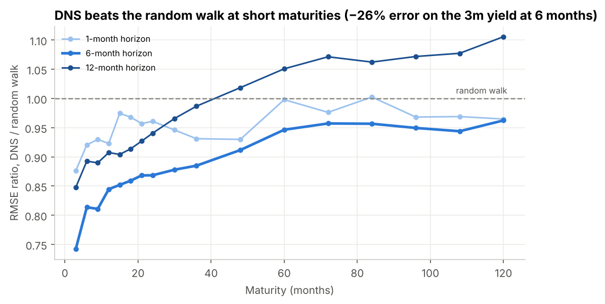
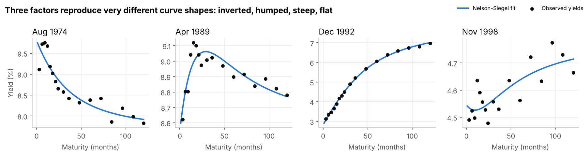
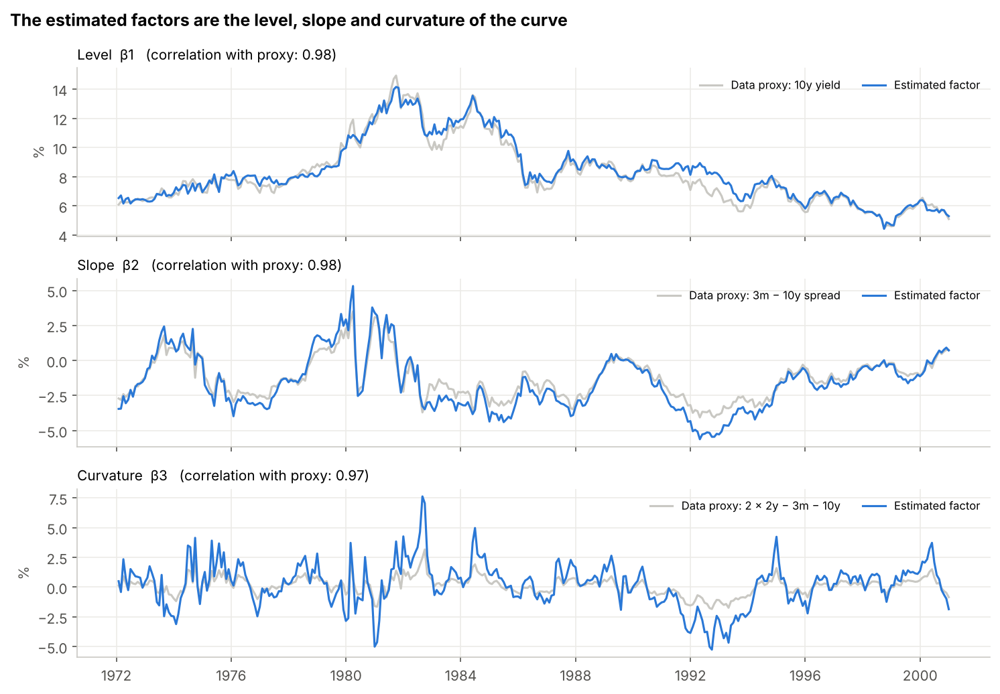
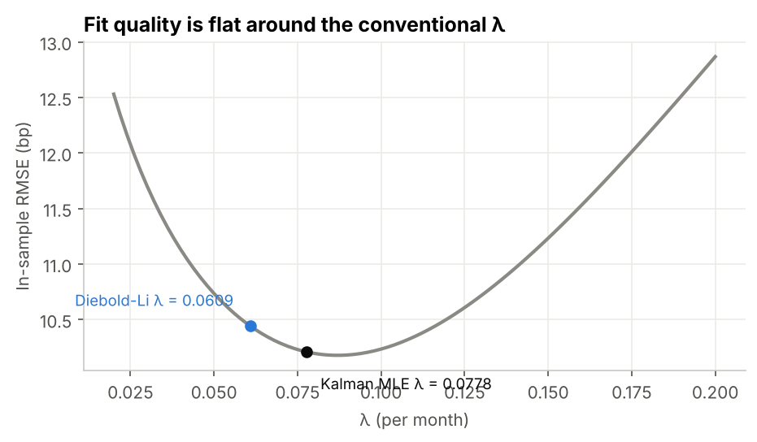

# Forecasting the US yield curve with Dynamic Nelson-Siegel and Svensson models

[](https://github.com/norahabrich/Dynamic-Nelson-Siegel-and-Svensson/actions/workflows/ci.yml)

[](LICENSE)

**Result:** forecasting 6 months ahead, the two-step Dynamic Nelson-Siegel model cuts the forecast error on the 3-month yield by **26%** compared with the random walk (RMSE 44 bp vs 60 bp, 1994-1999). At 12 months, the Kalman-filter version is the most accurate model on every maturity from 15 months to 10 years.



This project models the term structure of US Treasury yields with three factors (level, slope,
curvature), forecasts the curve 1, 6 and 12 months ahead, and tests the forecasts against simple
benchmarks on data the models never saw. It covers the two approaches of the literature: the
two-step method of Diebold & Li (2006) and the one-step state-space model estimated with the
Kalman filter (Diebold, Rudebusch & Aruoba, 2006).

Why it matters: the level, slope and curvature factors are how ALM, risk and rates desks summarise
interest-rate risk, build curve scenarios and stress tests, and price fixed-income books.

## Results

Out-of-sample RMSE in basis points, forecast origins Jan 1994 – Dec 1999 (72 months), expanding window. **Bold** = best model; † = significantly different from the random walk (Diebold-Mariano, 5%).

**1-month horizon**

| Model | 3m | 1y | 3y | 5y | 10y |
|---|---:|---:|---:|---:|---:|
| Random walk | 17.7 | 24.5 | 28.7 | 28.2 | 26.0 |
| AR(1) on each yield | 17.1 | 23.9 | 28.4 | 28.1 | 26.0 |
| DNS two-step (AR1) | 15.6 | 22.6 | 26.7 | 28.2 | **25.1** |
| DNS two-step (VAR1) | 18.7 | 23.7 | 27.8 | 28.9 | 26.2 |
| Svensson two-step (AR1) | **15.3** | **21.4†** | **26.1†** | **27.4** | 25.3 |
| DNS Kalman (VAR1) | 18.7 | 24.1 | 28.0 | 28.8 | 27.1 |

**6-month horizon**

| Model | 3m | 1y | 3y | 5y | 10y |
|---|---:|---:|---:|---:|---:|
| Random walk | 59.5 | 73.7 | 81.6 | 80.3 | 72.5 |
| AR(1) on each yield | 57.0 | 72.0 | 81.4 | 81.6 | 76.8 |
| DNS two-step (AR1) | 44.2 | 62.3 | 72.2 | **76.0** | **69.8** |
| DNS two-step (VAR1) | 66.1 | 73.5 | 78.6 | 80.2 | 73.0 |
| Svensson two-step (AR1) | **41.3** | **60.8** | **72.2** | 76.5 | 73.2 |
| DNS Kalman (VAR1) | 59.7 | 69.7 | 74.9 | 76.1 | 69.8 |

**12-month horizon**

| Model | 3m | 1y | 3y | 5y | 10y |
|---|---:|---:|---:|---:|---:|
| Random walk | 89.4 | 94.0 | 101.8 | 104.0 | 97.1 |
| AR(1) on each yield | 87.1 | 97.3 | 109.4 | 114.1 | 116.1 |
| DNS two-step (AR1) | 75.8 | **85.3** | 100.4 | 109.3 | 107.4 |
| DNS two-step (VAR1) | 123.8 | 114.6 | 113.5 | 115.8 | 111.0 |
| Svensson two-step (AR1) | **74.2** | 88.8 | 102.7 | 111.7 | 113.7 |
| DNS Kalman (VAR1) | 91.5 | 86.6 | **90.3** | **95.5** | **93.6** |

In-sample RMSE in basis points, 1972–2000:

| Model | 3m | 1y | 3y | 5y | 10y | All |
|---|---:|---:|---:|---:|---:|---:|
| Nelson-Siegel (two-step) | 16.0 | 11.4 | 8.5 | 10.0 | 13.4 | 10.4 |
| Svensson (two-step) | 6.3 | 8.1 | 6.3 | 7.3 | 12.1 | 8.4 |
| Nelson-Siegel (Kalman) | 25.6 | 10.0 | 7.4 | 8.6 | 16.4 | 11.2 |

What the numbers say:

- **Short and medium maturities:** at the 6-month horizon the two-step factor models beat the random walk on every maturity up to 3 years, by 12% to 26% (DNS) and up to 31% (Svensson on the 3-month yield).
- **Long maturities, long horizon:** at 12 months the two-step models lose to the random walk on the 5- and 10-year yields, while the Kalman model is the best model on every maturity from 15 months to 10 years (90 bp vs 102 bp on the 3-year yield, 96 bp vs 104 bp on the 5-year).
- **Simple dynamics win:** an AR(1) per factor forecasts better than a VAR(1) on the three factors, as Diebold & Li (2006) found: the cross-factor terms add estimation noise rather than information.
- **Svensson** fits the curve better in sample (8.4 bp vs 10.4 bp) and gives the only statistically significant gains over the random walk (1-month horizon, 1- to 4-year maturities).
- **The random walk is hard to beat:** with 72 forecast months most differences are not significant at 5%. This is the standard finding of the literature, and the reason any forecasting claim should come with a benchmark and a test.

## The model

Nelson & Siegel (1987) describe the whole yield curve with three numbers. The yield at maturity τ is

```
y(τ) = β1 + β2 · (1 − e^(−λτ)) / (λτ) + β3 · [ (1 − e^(−λτ)) / (λτ) − e^(−λτ) ]
```

- **β1, level**: moves all yields together (correlation 0.98 with the 10-year yield);
- **β2, slope**: weighs mostly on short maturities (correlation 0.98 with the 3m − 10y spread);
- **β3, curvature**: weighs on medium maturities and creates humps (correlation 0.97 with 2·2y − 3m − 10y).

Svensson (1994) adds a second curvature term with its own decay λ2, which helps fit curves with two humps.





Two ways to make the model dynamic:

| | Two-step (Diebold & Li, 2006) | One-step Kalman (Diebold, Rudebusch & Aruoba, 2006) |
|---|---|---|
| Step 1 | Fix λ = 0.0609, estimate β by OLS each month | Write the model in state-space form |
| Step 2 | Fit an AR(1) per factor (or a VAR(1)) on the estimated β | Estimate λ, the VAR(1) dynamics and measurement errors jointly by maximum likelihood |
| Strength | Simple, fast, robust | Uses all the information at once, gives filtered factors and uncertainty |

The maximum-likelihood λ is 0.0778, close to the minimum of the in-sample fit error; the
conventional 0.0609 is on a flat part of the curve, so the choice matters little for the fit.



### Backtest design

- Data: monthly unsmoothed Fama-Bliss zero-coupon US Treasury yields, January 1972 to December 2000,
  17 maturities from 3 months to 10 years (the dataset of Diebold & Li, 2006), in `data/bonds.csv`.
- Expanding window: at each month from January 1994, every model is re-estimated using only data
  available at that date, then forecasts the full curve 1, 6 and 12 months ahead. The same forecast
  origins are used for all horizons, so that horizons are comparable.
- Kalman model: parameters re-estimated every 12 months (warm start), factors filtered every month.
- Benchmarks: random walk (no change) and an AR(1) on each yield. Accuracy is measured by the root
  mean squared error (RMSE) in basis points, and tested against the random walk with the
  Diebold-Mariano test (Harvey-Leybourne-Newbold correction, Newey-West variance).

### Limitations

- The out-of-sample period (1994-2000) is short, so few differences are statistically significant.
- The sample stops in 2000; the next step is to rerun the backtest on recent data
  (Fed GSW curve or ECB euro-area curve) covering the zero-rate period and the 2022-2023 inversion.
- The model does not impose absence of arbitrage (see the arbitrage-free Nelson-Siegel of
  Christensen, Diebold & Rudebusch, 2011).

## Reproduce

```bash
pip install -r requirements.txt
python run_all.py          # every table and figure, about 10 minutes
python run_all.py --fast   # without the Kalman backtest, under 2 minutes
pytest -q                  # unit tests
```

A short guided tour is in [`notebooks/demo.ipynb`](notebooks/demo.ipynb).

```
dnsmodel/        Python package
  loadings.py    Nelson-Siegel and Svensson factor loadings
  two_step.py    Diebold-Li two-step estimation and forecasts
  kalman.py      state-space DNS, Kalman filter and maximum likelihood
  backtest.py    expanding-window backtest, RMSE, Diebold-Mariano test
run_all.py       reproduces results/ and figures/
results/         RMSE tables, Diebold-Mariano tests, Kalman parameters
tests/           unit tests (run by GitHub Actions)
legacy/R/        original R code by Werley Cordeiro
```

## Credits and references

This project started from the R implementation of the two-step DNS and DNSS models by
[Werley Cordeiro](https://github.com/werleycordeiro), kept in [`legacy/R`](legacy/R) with his
derivation of the Nelson-Siegel equations ([`docs/Nelson_Siegel_Math.pdf`](docs/Nelson_Siegel_Math.pdf)).
The Python package, the Kalman filter estimation, the out-of-sample backtest, the tests and the
figures were added on top of it.

- Nelson, C. R. & Siegel, A. F. (1987). Parsimonious modeling of yield curves. *Journal of Business*, 60(4).
- Svensson, L. E. O. (1994). Estimating and interpreting forward interest rates: Sweden 1992-1994. NBER Working Paper 4871.
- Diebold, F. X. & Li, C. (2006). Forecasting the term structure of government bond yields. *Journal of Econometrics*, 130(2).
- Diebold, F. X., Rudebusch, G. D. & Aruoba, S. B. (2006). The macroeconomy and the yield curve: a dynamic latent factor approach. *Journal of Econometrics*, 131(1-2).
- Diebold, F. X. & Mariano, R. S. (1995). Comparing predictive accuracy. *Journal of Business & Economic Statistics*, 13(3).
- Koopman, S. J., Mallee, M. I. P. & Van der Wel, M. (2010). Analyzing the term structure of interest rates using the dynamic Nelson-Siegel model with time-varying parameters. *Journal of Business & Economic Statistics*, 28(3).
